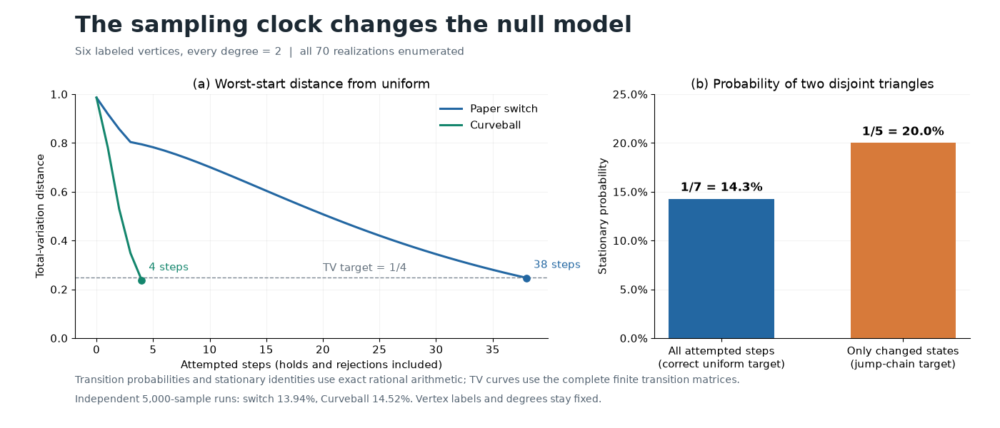

# 第三阶段：可以直接用于网络对照实验的采样器

本轮将第 131 组手稿转成一个可运行工具：输入每个节点的连接数，输出保留这些连接数的随机网络。它适合生成网络分析中的随机对照组，例如比较三角形、聚集或连通分量是否异常。

## 实际解决的问题

采样器提供两种后端：`switch` 精确实现论文指定的半惰性四节点交换；`curveball` 实现证明中使用的节点对重分配。两者都统计每次尝试，包括失败和原地停留。

这个计时约定有实际影响。在每个节点连接数均为 2 的六节点网络中，共有 70 个带标签的网络：60 个六环、10 个由两个三角形组成。均匀采样时，两个三角形的概率为 `10/70=1/7`。如果只保留成功改变网络的时刻，其平稳概率会变成 `1/5`，相对高出 40%。



## 验证结果

- 独立穷举 9 组连接数、共 105 个状态，构造 18 个有理数转移矩阵；逐项检查行列和、对称性、均匀平稳分布和可达性。
- 将真实采样器的随机选择逐项展开，28 个转移行与独立参考矩阵完全一致。
- 在六节点、连接数均为 2 的完整状态空间中，最坏起点到总变差距离 `1/4`：论文交换规则需要 38 次尝试，Curveball 需要 4 次。
- 两种后端各生成 5,000 个样本；两个三角形的频率分别为 13.94% 和 14.52%，均靠近目标 14.29%。完整频数保存在报告中。

以上 38 与 4 是这一个可穷举实例的完整矩阵计算结果。较大网络提供保守的论文推导步数界和实际运行统计。基准覆盖 16、32、64、128 个节点；每种后端每例运行 20,000 次尝试，节点连接数保持不变。

## 使用

```console
python -m math_to_code sample-graphs --degrees 2,2,2,2,2,2 --backend curveball --count 100 --burn-in 128 --spacing 10 --seed 131 --output results/networks.json
```

```python
from math_to_code.graphs import GraphSampler
sampler = GraphSampler([2, 2, 2, 2, 2, 2], seed=131, backend="curveball")
graphs = sampler.sample(100, burn_in=128, spacing=10)
```

节点标签从 0 开始，输入连接数逐一对应这些标签。输出包括边列表、种子和完整计数。它采样所有满足连接数的简单无向带标签网络，允许连通性变化；连续样本也允许重复。

## 重放与来源

```console
python scripts/audit_graphs.py
python scripts/benchmark_graphs.py
python scripts/plot_graphs.py
```

[完整有理数转移矩阵、状态与频数](../results/graph_audit.json) · [基准](../results/graph_benchmark.json) · [示例输出](../results/graph_samples_example.json) · [算法、推导与已有工具比较](graph-sampling-method.md)

交换和 Curveball 方法已有研究与软件基础。本项目新增的是这两个明确核的实现、可重放的输出和完整小状态空间审计；原方法与论文贡献在方法文档中分别注明。
