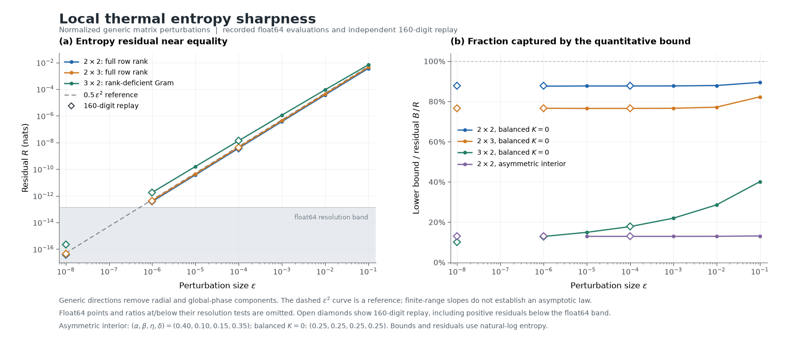

# 第二阶段：从数值审计走向定量分析

日期：2026-10-17。第一阶段完成公式与基本审计；这一阶段研究不等式的差值如何随输入变化，并把推导所得的下界加入可调用接口。

## 得到的定量下界

令 `A=XX*`、`B=YY*`，`R` 是原不等式左右两边的差。根据原论文的两个端点分解，再用自然对数约定下的量子 Pinsker 不等式，可得

\[
R\ge \frac{\beta\eta}{2U_0U_1}\|A-B\|_1^2.
\]

`U0`、`U1` 是两行系数之和。这个式子把两个状态的差异转成最小熵差，且不依赖矩阵维数。[完整推导、边界情况和来源](thermal-stability-derivation.md) 已写出。计算接口为 `math_to_code.thermal.gap_lower_bound`。

另一个直接结论是：在满行秩、正参数且一阶 Gram 变化不为零的扰动方向上，差值按扰动幅度的平方阶增长。推导还给出比 `X=Y` 更广的取等号构造，并解释了为什么某些边界输入即使不交换也可以取等号。

## 实验与复核

| 工作 | 规模 | 结果 |
|---|---|---|
| 定量下界和结构化取等号检查 | 4,146 个矩阵实例，加 2 个标量边界检查 | 全部通过 |
| 扰动路径 | 396 条路径，3,168 次计算 | 108 条普通扰动路径的可分辨斜率为 1.87–2.09 |
| 有约束并行搜索 | 24 个工作进程、128 个起点、191,995 次评估 | 保存了所有最好可行点；最小差值约 `3.6327462e-5` nats |
| 高精度复核 | 9 个搜索输入、36 个扰动点，各计算 80／160 位 | 45 组精度对照全部一致；最小正差值约 `2.2583e-17` nats |
| 独立因子谱对照 | 9 个搜索输入 | 直接特征值与因子奇异值计算全部一致 |

在本批可分辨样本中，新下界覆盖实际差值的约 0.78%–89.47%；最接近的一例达到 89.47%。这说明它不只是形式上的正数，也能给部分输入提供有量级意义的校验。

并行搜索中 127 个起点用完了每点 1,500 次评估预算，1 个报告收敛。表中的数值是已找到的最好可行值。`3x2` 的输出 Gram 必然秩亏，不能直接套用满行秩情况下的平滑性论证。

## 可重放材料

- [定量下界检查](../results/thermal_stability.json)
- [扰动路径及全部样本](../results/thermal_perturbations.json) · [CSV](../results/thermal_perturbations.csv)
- [并行搜索与完整候选输入](../results/sharpness_search.json)
- [80／160 位复核](../results/thermal_high_precision.json)
- [完整工作进程日志下载](https://github.com/wubingshuazi/math-to-code/releases/download/v0.2.0/thermal_search_journals.zip) · [逐文件校验值](../results/research_artifacts.json)

图表由 `scripts/plot_thermal_sharpness.py` 根据已保存数据生成：

实验使用 Windows、Python 3.14.3、NumPy 2.5.4、SciPy 1.18.1、mpmath 1.4.1。数学推导是原证明与已知熵不等式的推论；搜索和高精度计算用于探索、核对具体输入。
